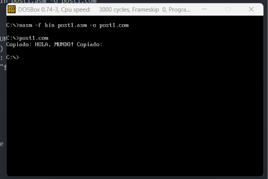
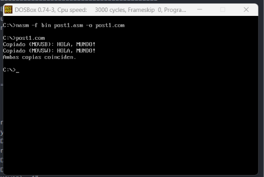
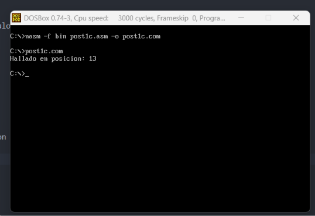
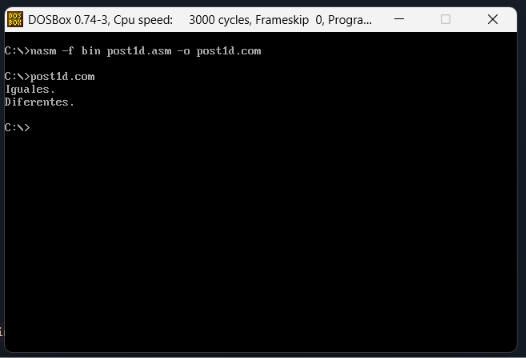
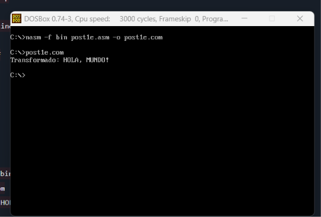

# Post-contenido Unidad 8 — Operaciones con Cadenas y Aritmética en NASM sobre DOSBox

**Asignatura:** Arquitectura de Computadores
**Herramientas:** NASM, DOSBox 0.74 (programas `.com`, modo real de 16 bits)

Este repositorio reúne las dos partes del laboratorio: la Parte 1 trabaja las instrucciones de cadena y la Parte 2 la aritmética de precisión múltiple y BCD. Todos los programas se ensamblan con `nasm -f bin archivo.asm -o archivo.com` y se ejecutan en DOSBox.

## Estructura del repositorio

| Archivo      | Parte | Contenido                                                  |
| ------------ | ----- | ---------------------------------------------------------- |
| `post1.asm`  | 1     | Copia con `REP MOVSB` y versión optimizada con `REP MOVSW` |
| `post1c.asm` | 1     | Búsqueda de un carácter con `REPNE SCASB`                  |
| `post1d.asm` | 1     | Comparación de cadenas con `REPE CMPSB`                    |
| `post1e.asm` | 1     | Copia con transformación a mayúsculas (`LODSB` + `STOSB`)  |
| `post2.asm`  | 2     | Suma y resta de 32 bits con `ADC` y `SBB`                  |
| `post2b.asm` | 2     | Suma y resta BCD empaquetada con `DAA` y `DAS`             |
| `post2c.asm` | 2     | Mini calculadora con `MUL`, `DIV` y `AAM`                  |
| `post2d.asm` | 2     | Suma y resta BCD desempaquetada con `AAA` y `AAS`          |

Cada `.asm` incluye su `.com` generado y las capturas de DOSBox (carpeta `capturas/`).

## Capturas

### Parte 1

#### `post1.asm` — P1-CP1

#### `post1.asm` — P1-CP2

#### `post1c.asm` — P1-CP3

#### `post1d.asm` — P1-CP4

#### `post1e.asm` — P1-CP5

## 

## Decisiones técnicas de la Parte 1

### Decisión 1 — ¿REP MOVSB o un bucle manual con LODSB/STOSB?

`REP MOVSB` es más rápido que el bucle manual para una copia byte a byte sin transformación porque el procesador la ejecuta como un ciclo optimizado en microcódigo. Se decodifica una sola instrucción y el hardware repite internamente la lectura, la escritura y el avance de SI, DI y CX. El bucle de `post1e.asm`, en cambio, paga en cada byte la decodificación de `lodsb`, `cmp`, el salto condicional, `stosb` y `loop`. Además, cada salto condicional puede perturbar la predicción de saltos. Aun así, fue necesario abandonar `REP MOVSB` en `post1e.asm` porque esa instrucción mueve bytes sin inspeccionarlos: no ofrece ningún punto intermedio donde comprobar si el carácter es una minúscula y restarle 20h. Solo el bucle manual permite insertar esa lógica entre la carga y el almacenamiento. Si el laboratorio necesitara copiar una cadena larga sin ninguna transformación, `REP MOVSB` seguiría siendo la opción preferible por su menor costo de ejecución y su código más corto. El bucle manual queda reservado para los casos en que se requiere lógica adicional por carácter, aceptando su costo de rendimiento a cambio de flexibilidad.

### Decisión 2 — ¿CX fijo en REPE CMPSB/REPNE SCASB o verificación manual del terminador?

`REPE CMPSB` y `REPNE SCASB` no conocen el terminador nulo: solo se detienen cuando CX llega a 0 o cuando se cumple la condición de comparación. Si se comparan con CX=8 dos cadenas terminadas en nulo de 5 y 8 caracteres, la instrucción leería, después del nulo de la cadena corta, los 2 bytes siguientes de memoria adyacente (la posición 6 y la 7), que no pertenecen a esa cadena. Normalmente el nulo ya difiere del carácter de la cadena larga y la comparación se detiene ahí. Pero si ambas cadenas coinciden hasta el terminador y la memoria vecina casualmente coincide también, el resultado puede ser incorrecto o impredecible, y una lectura así puede cruzar hacia datos ajenos. Para longitud desconocida se adapta el bucle de `post1e.asm`: se cargan los dos caracteres con `lodsb` (uno desde cada cadena, guardando uno en otro registro), se comparan y se termina en cuanto difieran o cualquiera de los dos sea el byte nulo, reemplazando `stosb` por esa comparación. En `post1d.asm`, `REPE CMPSB` con CX fijo es apropiado únicamente porque las tres cadenas literales miden exactamente 8 caracteres y esa longitud se conoce en tiempo de ensamblado, de modo que nunca se lee más allá de sus límites.
